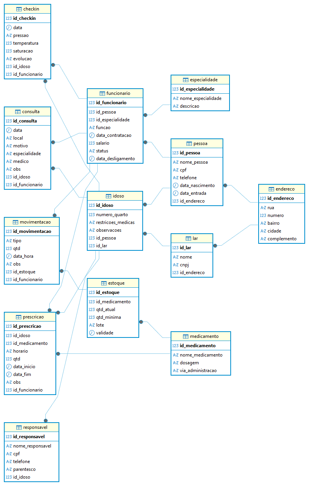

# LIFE PLUS

Projeto de modelagem de banco de dados desenvolvido para gerenciamento de uma Casa Lar / Casa de Idosos.

---

## Objetivo

O objetivo do projeto é criar uma estrutura de banco de dados capaz de gerenciar informações relacionadas a:

- Idosos
- Funcionários
- Quartos
- Medicamentos
- Consultas
- Observações e histórico

---

## Tecnologias Utilizadas

- PostgreSQL
- SQL
- brModelo / Visual Paradigm
- GitHub

---

## Arquivos do Projeto

| Arquivo | Descrição |
|---|---|
| LifePlus_Final.vpp | Versão final do projeto |

### Versões Antigas

- lifeplus01.vpp → Modelo inicial
- lifeplus02.vpp → Ajustes e melhorias
- lifeplus03.vpp → Últimos ajustes

---

## Desenvolvedores

<table>
  <tr>
    <td align="center">
       
      <b>Gabriel Leonir Becker</b> 
      Matrícula: 
      000000
    </td>
    <td align="center">
       
      <b>Gabriel Henrique Klein</b> 
      Matrícula: 
      449952
    </td>
    <td align="center">
      
      <b>Guilherme Removicz</b> 
      Matrícula: 
      000000
    </td>
    <td align="center">
       
      <b>Pedro Henrique Belloli</b> 
      Matrícula: 
      000000
    </td>
  </tr>
</table>
---
## Diagrama Entidade Relacionamento 

---
## Conceitos Utilizados

- Modelagem Entidade-Relacionamento
- DDL
- Chaves Primárias
- Chaves Estrangeiras
- Relacionamentos
- Normalização

---

## Status do Projeto

 Em desenvolvimento

---

## Instituição

UNOESC - Universidade do Oeste de Santa Catarina
